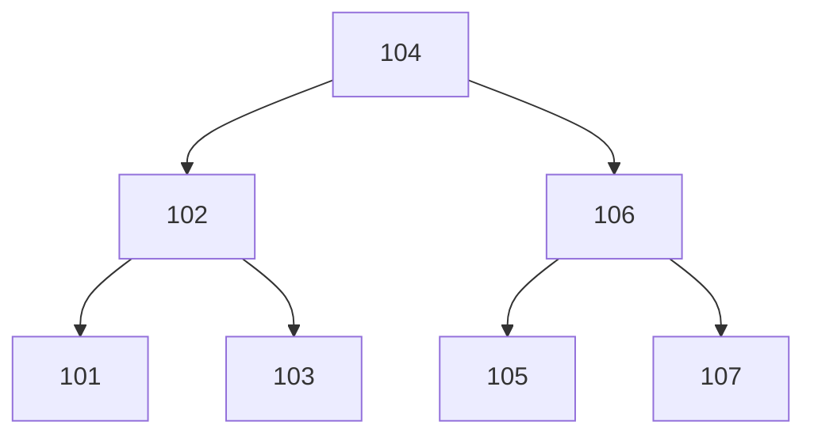

# 280: trees, data that branches
builds on: [273 binary search, finding one item in sorted data by halving](./273-binary-search-finding-one-item-in-sorted-data-by-halving.md), [040 folders and paths](./040-folders-and-paths.md), [269 big O in plain words, how work grows as data grows](./269-big-o-in-plain-words-how-work-grows-as-data-grows.md)
section: tricks that make data fast, part 12, ~2 min read

in [273](./273-binary-search-finding-one-item-in-sorted-data-by-halving.md) i halved the order ids 101 to 107 and found 107 in 3 looks, a look being one id checked. what if you drew them?

you get a tree: values stored in nodes (boxes holding one value), where each node points down to its children, the nodes right under it. the top node is the root, and nodes with no children are leaves. its the same word as the top folder in [040](./040-folders-and-paths.md), and a folder holding folders is a tree too.

the shop, the imaginary gujarati snack store these notes run on, has orders 101 to 107. smaller ids go left, bigger go right:

finding 107: at the root 104, 107 is bigger, go right. at 106, bigger again, go right. thats 107, 3 looks. 102, 101, 103 and 105 never get touched, each step drops a whole side. 104, 106, 107 are the same middles as the halving in 273.

so a lookup follows one path, one node per level, and this tree has 3 levels. walking all 7 ids one by one, like [269](./269-big-o-in-plain-words-how-work-grows-as-data-grows.md), took 7 looks.

real databases use this. Postgres, a popular one, builds its indexes (lookup shortcuts) as B-trees by default, a kind of tree ([docs](https://www.postgresql.org/docs/current/indexes-types.html)).

i assumed a tree was some fancy structure, but its the halving i knew with the middles drawn as boxes.

this one is only tidy because i picked the order. what if the ids arrive as 101, 102, 103 in a row? the next one.

---
prev: [279 collisions, when two keys land in the same spot](./279-collisions-when-two-keys-land-in-the-same-spot.md) | next: not written yet
