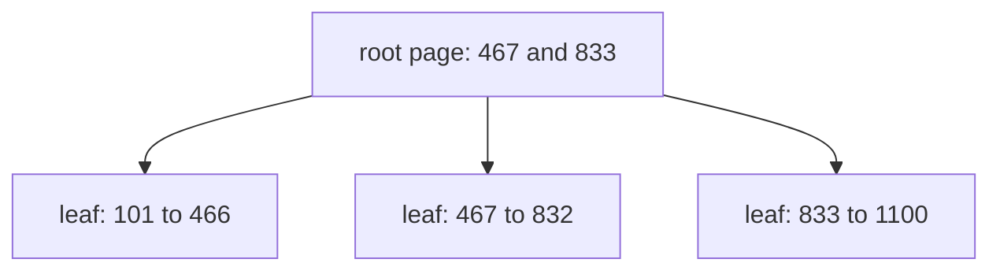

# 287: B tree, pages that point to pages
builds on: [286 index, a sorted shortcut to rows](./286-index-a-sorted-shortcut-to-rows.md), [284 how Postgres keeps a table on disk, rows packed into pages](./284-how-postgres-keeps-a-table-on-disk-rows-packed-into-pages.md), [281 balanced trees, why the depth stays small](./281-balanced-trees-why-the-depth-stays-small.md), [280 trees, data that branches](./280-trees-data-that-branches.md)
section: inside a database server, part 4, ~2 min read

finding an order among 1000 took 10 looks in [286](./286-index-a-sorted-shortcut-to-rows.md), a look being one value checked in a sorted shortcut to rows. so how did Postgres read only 2 index pages for it?

because its index isnt one value per node. a B tree is the tree of [280](./280-trees-data-that-branches.md) where every node is a whole page (an 8192 byte chunk, from [284](./284-how-postgres-keeps-a-table-on-disk-rows-packed-into-pages.md)) holding many sorted values. pages above the bottom hold signposts, each entry pointing to a child page. the leaves, the bottom pages, hold the real entries: a value plus the rows address (its page and slot) from 286.

the shop, the imaginary gujarati snack store these notes run on, here as the 1000 made up orders of 286. this is the index on order_id that Postgres 16, a database server, built in one go:



two signposts, three children: below 467 go left, 467 up to 832 go middle, 833 and up go right. a page with n signposts has n + 1 children. the leaves hold 366, 366 and 268 entries, so a lookup reads the root and one leaf, 2 pages.

i assumed a B tree was a two-way tree with a fancier name, but each node just got fat, so the tree is short and a step skips most of the ids.

short means few disk reads, and you pay a whole page for each. the Postgres docs say over 99% of an index is typically leaf pages ([docs](https://www.postgresql.org/docs/16/btree-implementation.html)).

### check yourself

1. a toy B tree for the 7 shop orders has a root with signposts 104 and 107, and leaves of at most 3 entries. which orders sit in the middle leaf?

```sql
SELECT order_id FROM orders WHERE order_id >= 104 AND order_id < 107 ORDER BY order_id;
```

<details><summary>answer</summary>

```result
order_id
104
105
106
```

104 sits in the middle leaf because a signpost value belongs to the side above it, like 467 in the real index. the tempting answer is 105 and 106 only, from reading the signposts as walls that are themselves left out.

</details>

2. a toy root page can hold 299 signposts and each leaf page 300 entries. at most how many orders does a 2 level tree hold?

<details><summary>answer</summary>

at most 90000, because 299 signposts give 300 children, and 300 leaves of 300 entries is 90000. the tempting answer is 89700, from counting 299 leaves, one per signpost.

</details>

---
prev: [286 index, a sorted shortcut to rows](./286-index-a-sorted-shortcut-to-rows.md) | next: not written yet
