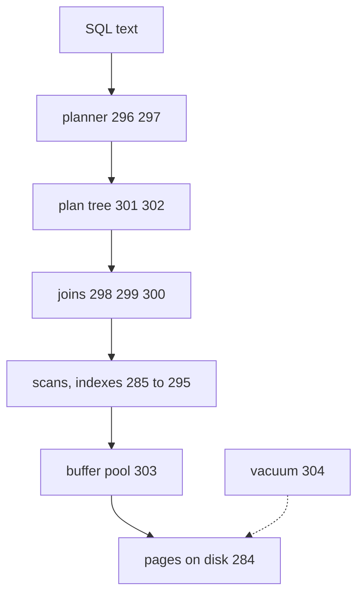

# 305: capstone, one query from SQL text to rows on disk
builds on: [284 how Postgres keeps a table on disk, rows packed into pages](./284-how-postgres-keeps-a-table-on-disk-rows-packed-into-pages.md), [285 full table scan, reading every page](./285-full-table-scan-reading-every-page.md), [286 index, a sorted shortcut to rows](./286-index-a-sorted-shortcut-to-rows.md), [287 B tree, pages that point to pages](./287-b-tree-pages-that-point-to-pages.md), [288 one lookup traced through a B tree](./288-one-lookup-traced-through-a-b-tree.md), [289 how a B tree stays balanced as rows arrive](./289-how-a-b-tree-stays-balanced-as-rows-arrive.md), [290 composite indexes, sorted by the first column, then the second](./290-composite-indexes-sorted-by-the-first-column-then-the-second.md), [291 the leftmost prefix rule, which questions a composite index can answer](./291-the-leftmost-prefix-rule-which-questions-a-composite-index-can-answer.md), [292 covering index, when the index alone has the answer](./292-covering-index-when-the-index-alone-has-the-answer.md), [293 what indexes cost, slower writes and more disk](./293-what-indexes-cost-slower-writes-and-more-disk.md), [294 selectivity, when an index doesnt help](./294-selectivity-when-an-index-doesnt-help.md), [295 functions on a column, why the index gets skipped](./295-functions-on-a-column-why-the-index-gets-skipped.md), [296 the query planner, picking the cheapest plan](./296-the-query-planner-picking-the-cheapest-plan.md), [297 statistics, how the planner guesses row counts](./297-statistics-how-the-planner-guesses-row-counts.md), [298 nested loop join, for each outer row search the inner side](./298-nested-loop-join-for-each-outer-row-search-the-inner-side.md), [299 hash join, build a hash table then look up each row](./299-hash-join-build-a-hash-table-then-look-up-each-row.md), [300 merge join, walk two sorted lists side by side](./300-merge-join-walk-two-sorted-lists-side-by-side.md), [301 reading EXPLAIN, the plan as a tree](./301-reading-explain-the-plan-as-a-tree.md), [302 EXPLAIN ANALYZE, the planners guesses vs what really happened](./302-explain-analyze-the-planners-guesses-vs-what-really-happened.md), [303 the buffer pool, keeping hot pages in memory](./303-the-buffer-pool-keeping-hot-pages-in-memory.md), [304 vacuum, how Postgres cleans up old row versions](./304-vacuum-how-postgres-cleans-up-old-row-versions.md)
section: inside a database server, wrap up, ~3 min read

you send Postgres (a database that runs as its own server) one SELECT, a request for rows, and rows come back. what happens in between, and which steps actually read the disk? [304](./304-vacuum-how-postgres-cleans-up-old-row-versions.md) ended on vacuum, the cleanup of old row versions, which runs as its own job, not inside your query.

this is the query from [301](./301-reading-explain-the-plan-as-a-tree.md), cancelled orders per customer, on the shop, the imaginary gujarati snack store these notes run on, as 100000 made up orders in Postgres 16. the request goes down this picture, the rows come back up it:



| step | what it decides | notes |
|---|---|---|
| planner | lists the ways to run it, scores each (a made up number, not time) from saved summaries of the data, keeps the lowest | [296](./296-the-query-planner-picking-the-cheapest-plan.md) [297](./297-statistics-how-the-planner-guesses-row-counts.md) |
| plan tree | the winner as boxes, rows flowing up; EXPLAIN prints it, EXPLAIN ANALYZE runs it and adds real row counts | [301](./301-reading-explain-the-plan-as-a-tree.md) [302](./302-explain-analyze-the-planners-guesses-vs-what-really-happened.md) |
| joins | pairing each order with its customer: loop inside a loop, hash table, or two sorted lists | [298](./298-nested-loop-join-for-each-outer-row-search-the-inner-side.md) [299](./299-hash-join-build-a-hash-table-then-look-up-each-row.md) [300](./300-merge-join-walk-two-sorted-lists-side-by-side.md) |
| scans | read every page, or follow a sorted shortcut (an index) to just the right ones | [285](./285-full-table-scan-reading-every-page.md) [286](./286-index-a-sorted-shortcut-to-rows.md) [287](./287-b-tree-pages-that-point-to-pages.md) [288](./288-one-lookup-traced-through-a-b-tree.md) [289](./289-how-a-b-tree-stays-balanced-as-rows-arrive.md) |
| which index fits | column order, covering, cost, how few rows match, a function on the column | [290](./290-composite-indexes-sorted-by-the-first-column-then-the-second.md) [291](./291-the-leftmost-prefix-rule-which-questions-a-composite-index-can-answer.md) [292](./292-covering-index-when-the-index-alone-has-the-answer.md) [293](./293-what-indexes-cost-slower-writes-and-more-disk.md) [294](./294-selectivity-when-an-index-doesnt-help.md) [295](./295-functions-on-a-column-why-the-index-gets-skipped.md) |
| buffer pool | memory holding copies of pages already fetched, a hit skips the disk | [303](./303-the-buffer-pool-keeping-hot-pages-in-memory.md) |
| pages | the 8192 byte chunks of the table file that hold the rows | [284](./284-how-postgres-keeps-a-table-on-disk-rows-packed-into-pages.md) |
| vacuum | frees old row versions in those pages, its own job | [304](./304-vacuum-how-postgres-cleans-up-old-row-versions.md) |

cover the words and the picture still says it: the planner and the plan decide before anything is read, and only the scans pull in pages, from the buffer pool if they are there and the disk if not. the planner works from saved summaries, so a slow query starts with EXPLAIN ANALYZE, comparing guessed rows to real ones. a big gap often means stale statistics, the summaries ANALYZE builds, though lumpy data can do it too. no gap and still slow, look at the scans, like a function wrapped around an indexed column. careful, EXPLAIN ANALYZE really runs the query, so an UPDATE inside it really updates.

i assumed the database was one big step, but it thinks first and only fetches pages at the end.

### check yourself

1. someone adds an index on status to the 7 real orders and expects the cancelled query to switch to it. what does the planner do, and what does this return?

```sql
SELECT order_id, status FROM orders WHERE status = 'cancelled';
```

<details><summary>answer</summary>

```result
order_id | status
104 | cancelled
```

it still picks a Seq Scan, because the whole table is one page and reading it costs 1.09 against 8.15 for the index route, as the planner note showed, and the query returns the one row above. the tempting answer is that the index wins because cancelled is rare, but selectivity only matters once the table is big enough for pages to cost something.

</details>

2. EXPLAIN ANALYZE shows an Index Scan guessed at 5 rows that returned 50000. which earlier piece gave the bad guess, and what refreshes it: ANALYZE or VACUUM?

<details><summary>answer</summary>

the statistics, the saved shares of common values that ANALYZE builds from a sample. a stale set gives bad guesses, and ANALYZE refreshes it. plain VACUUM frees dead row versions instead, but VACUUM ANALYZE does both, which is why they get mixed up. the tempting answer is VACUUM, since both sound like cleanup.

</details>

---
prev: [304 vacuum, how Postgres cleans up old row versions](./304-vacuum-how-postgres-cleans-up-old-row-versions.md) | next: [306 DNS, turning names into addresses](./306-dns-turning-names-into-addresses.md)
