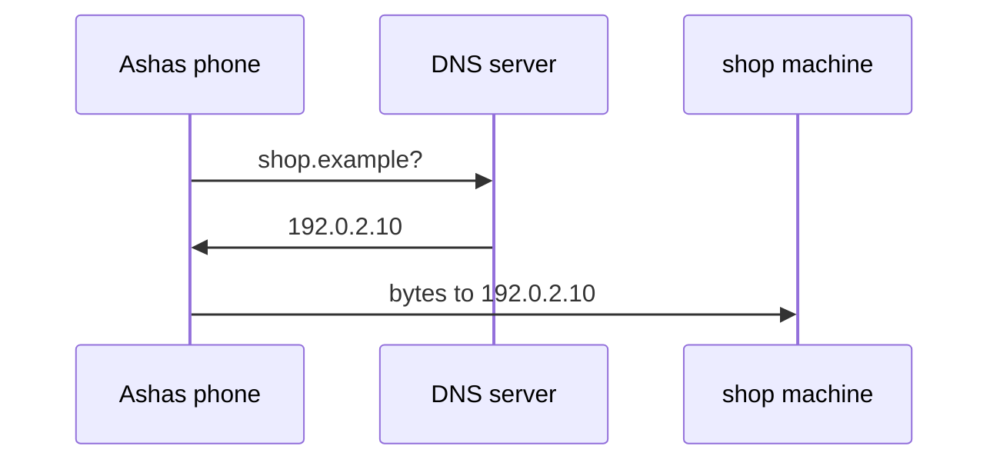

# 306: DNS, turning names into addresses
builds on: [305 capstone, one query from SQL text to rows on disk](./305-capstone-one-query-from-sql-text-to-rows-on-disk.md), [278 hash tables, how a dictionary finds a key without searching](./278-hash-tables-how-a-dictionary-finds-a-key-without-searching.md), [085 addresses and ports, the right program on the right machine](./085-addresses-and-ports.md), [086 client and server, you ask, the database answers](./086-client-and-server.md)
section: talking over a network, part 1, ~2 min read

you type shop.example into a connection setting, but the network sends bytes to an address (a number naming one machine), like 192.0.2.10. [085](./085-addresses-and-ports.md) said you usually type a name that gets looked up as one. by whom? [305](./305-capstone-one-query-from-sql-text-to-rows-on-disk.md) stayed inside the database, and this section is the trip there.

DNS, the domain name system, is a lookup service: send it a host name, a text name for a machine, and it sends back an address. picture a giant [dictionary](./278-hash-tables-how-a-dictionary-finds-a-key-without-searching.md) (keys find values), names as keys and addresses as values, kept on DNS servers (simplified, real DNS is many servers in layers), a [server](./086-client-and-server.md) being a program that answers requests. here is Ashas phone reaching the shop, the imaginary gujarati snack store these notes run on:



the phone asks first and connects second. the connection goes to the address, the name is mostly what you typed to get it. so when the shop moves machines, someone changes one entry and no phone changes anything, once old cached answers expire. one name can also come back with several addresses (the [DNS spec](https://www.rfc-editor.org/rfc/rfc1034) recommends returning them all), so a name is not always one address.

localhost, the name for this same machine, (127.0.0.1) is usually answered from a file on it, no network involved:

```python
import socket
print(socket.gethostbyname("localhost"))
```

```output
127.0.0.1
```

i assumed the name was the destination, but its just a way to get the address. the bug it explains: "could not resolve host" means the lookup itself failed, not the connection refused in [085](./085-addresses-and-ports.md), where nobody listened.

---
prev: [305 capstone, one query from SQL text to rows on disk](./305-capstone-one-query-from-sql-text-to-rows-on-disk.md) | next: [307 URLs and query parameters](./307-urls-and-query-parameters.md)
