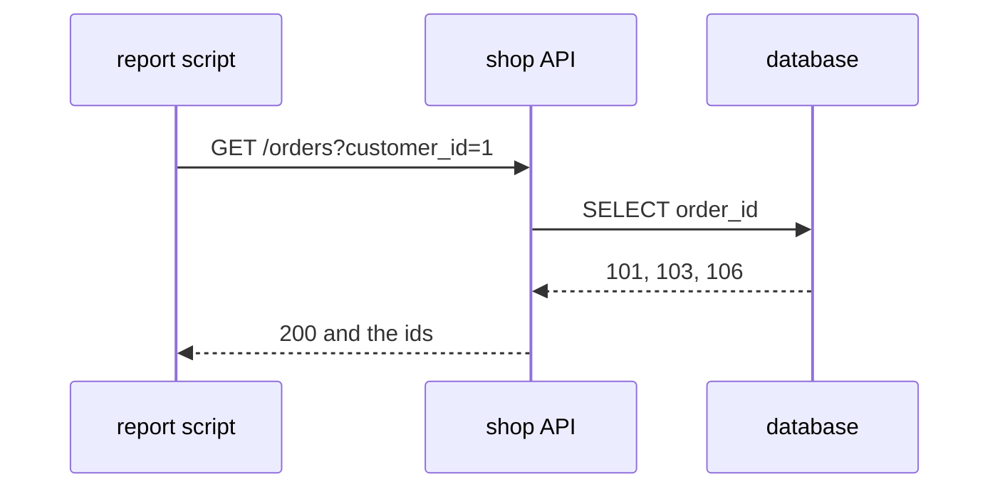

# 312: APIs, a door built for programs
builds on: [082 a database, a program that guards your data](./082-a-database-guards-the-data.md), [086 client and server, you ask, the database answers](./086-client-and-server.md), [307 URLs and query parameters](./307-urls-and-query-parameters.md), [309 HTTP methods, GET asks and POST sends](./309-http-methods-get-asks-post-sends.md), [311 status codes, what 200, 404 and 500 mean](./311-status-codes-what-200-404-and-500-mean.md)
section: talking over a network, part 7, ~2 min read

Asha can see her orders on the shop website, so why would the shop build a second door? a report script wanting her order ids would otherwise read that page the way a person does.

an API is a menu of requests a [server](./086-client-and-server.md) (a program that waits for requests) promises to answer for other programs, with a fixed shape for each answer. each request is an HTTP method plus a path, like GET /orders (i mean the web kind, a code library gets the name too). the shop, the imaginary gujarati snack store these notes run on, has one:



the script sends a [GET](./309-http-methods-get-asks-post-sends.md) with a [query](./307-urls-and-query-parameters.md) (a filter after the ?). the API runs SQL on the [database](./082-a-database-guards-the-data.md) (the program guarding the data) and answers with a [status code](./311-status-codes-what-200-404-and-500-mean.md), 200, plus the ids:

```sql
SELECT order_id FROM orders WHERE customer_id = 1 ORDER BY order_id
```

```result
order_id
101
103
106
```

the script never sees a table, so the shop can change columns or databases behind the API, and the script keeps working as long as the promised answer stays the same. a script reading the web page breaks if the text it searched for changes.

i kept waiting for the new technology part, and there isnt one. you have already met it, the same requests and codes from the last few notes, with a promise attached.

GitHub documents one: GET api.github.com/repos/octocat/Spoon-Knife/issues, on a different host from the website. what an answer looks like is its own question, a later note takes it.

### check yourself

1. the shop changes its page text from "Order 101" to "Order no. 101" and moves its data to a new database, keeping GET /orders?customer_id=1 answering the same. script A calls that GET. script B searches the page text for "Order 101". what happens to each?
<details><summary>answer</summary>

A keeps working, since the promise didnt change and the database behind it is hidden. B breaks, because the text it searched for is gone. the tempting answer is that A breaks too because the data moved, but A never touched the data directly.

</details>

2. the script asks GET /orders?customer_id=5, Esha, with the query below behind it. what status code does it get, and what is in the answer?
```sql
SELECT order_id FROM orders WHERE customer_id = 5 ORDER BY order_id
```
<details><summary>answer</summary>

```result
order_id
```

no rows, so an empty list with a 200, the usual choice for a list. the request was fine and the answer is just empty (the shop could choose otherwise). the tempting answer is 404, from [311](./311-status-codes-what-200-404-and-500-mean.md), but that was for asking for one order that doesnt exist, here Esha exists and just has no orders.

</details>

---
prev: [311 status codes, what 200, 404 and 500 mean](./311-status-codes-what-200-404-and-500-mean.md) | next: [313 JSON over HTTP, the answer is text until you parse it](./313-json-over-http-the-answer-is-text-until-you-parse-it.md)
