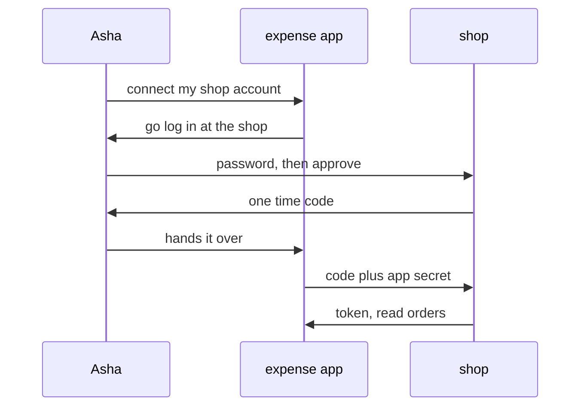

# 316: OAuth in one picture, a token without the password
builds on: [312 APIs, a door built for programs](./312-apis-a-door-built-for-programs.md), [314 API keys, a password for programs](./314-api-keys-a-password-for-programs.md), [315 tokens that expire, a key with a shelf life](./315-tokens-that-expire-a-key-with-a-shelf-life.md)
section: talking over a network, part 11, ~2 min read

an expense app wants to read Ashas orders. the lazy way is Asha typing her shop password into it, and i kept wondering who would ever accept that. would you?

OAuth is how an app gets a [token](./315-tokens-that-expire-a-key-with-a-shelf-life.md) (a key with an expiry) for someone, without ever seeing their password. the shop, the imaginary gujarati snack store these notes run on, has an [API](./312-apis-a-door-built-for-programs.md) (requests it promises to answer), and Asha is one of its customers. this is the common version, called the authorization code flow:



the password only ever goes to the shop. the app gets a code instead, which rides through Ashas browser, so it works once and the standard recommends 10 minutes at most. the app swaps it, usually with a secret it got when it signed up with the shop, and the token comes straight back.

i expected the app to end up holding some version of her login, but it holds a token that, in our shop, is saved as "Asha, read orders" plus an expiry, like the expiry in [315](./315-tokens-that-expire-a-key-with-a-shelf-life.md). "read orders" is the scope, the list of things the token may do, and the shop checks it on every request. if Asha stops trusting the app, the shop deletes that token and its refresh token (the longer lived key that swaps for new tokens), like a key in [314](./314-api-keys-a-password-for-programs.md). her password and other apps are untouched.

RFC 6749, the OAuth 2.0 standard, names old costs, like apps storing passwords.

### check yourself

1. the shop saved the expense apps token t_x1 as customer 1, read orders. the app sends t_x1 with GET /orders?customer_id=2, hoping to see Bhavins orders. if the shop trusts what it saved about the token, not the url, which query runs and what comes back?
<details><summary>answer</summary>

```sql
SELECT order_id FROM orders WHERE customer_id = 1 ORDER BY order_id
```

```result
order_id
101
103
106
```

Ashas 3 orders (a real API might refuse with an error instead, thats the shops choice). the tempting answer is Bhavins 102 and 107, from believing the 2 in the url, but the url is just what the caller typed and the token is what the shop remembers.

</details>

2. the expense app sends Asha to a page that looks exactly like the shops login, but it is the apps own page. she types her password there. did OAuth protect her?
<details><summary>answer</summary>

no. OAuth only keeps the password from the app when she types it at the real shop address, so she has to check the address bar for the real shop. the tempting answer is yes, because the flow was used, but a lookalike page skips the flow and just collects the password.

</details>

---
prev: [315 tokens that expire, a key with a shelf life](./315-tokens-that-expire-a-key-with-a-shelf-life.md) | next: not written yet
