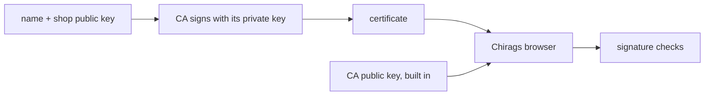

# 321: certificates, proving whose public key it is
builds on: [318 public and private keys, locking without sharing a secret](./318-public-and-private-keys-locking-without-sharing-a-secret.md), [319 cryptographic hashes, a fingerprint you cant reverse](./319-cryptographic-hashes-a-fingerprint-you-cant-reverse.md), [320 digital signatures, proof a message came from the key holder](./320-digital-signatures-proof-a-message-came-from-the-key-holder.md)
section: talking over a network, part 16, ~2 min read

[320](./320-digital-signatures-proof-a-message-came-from-the-key-holder.md) ended on an if: a signature proves the key holder wrote it, if that [public key](./318-public-and-private-keys-locking-without-sharing-a-secret.md), the half you share, really is theirs. what stops a thief posting their own and calling it shop.example?

a certificate is a small document saying "this public key belongs to this name", signed by a certificate authority, a CA, an organization your browser already trusts. the shop, the imaginary gujarati snack store these notes run on, doesnt ask Chirag to trust its key. it gets a CA to sign the name and the key together.



here is the check with the toy signing from [320](./320-digital-signatures-proof-a-message-came-from-the-key-holder.md), now with the CAs own toy key pair. the shop key is 17 with 3233, the pair from [318](./318-public-and-private-keys-locking-without-sharing-a-secret.md):

```python
import hashlib
n, public, private = 2773, 17, 157

def tiny_fp(text):
    return list(hashlib.sha256(text.encode()).digest()[:3])

def sign(text, key):
    return [pow(b, key, n) for b in tiny_fp(text)]

def check(text, sig, key):
    return [pow(s, key, n) for s in sig] == tiny_fp(text)

cert = "shop.example 17 3233"
sig = sign(cert, private)
print(check(cert, sig, public))
print(check("shop.example 7 6767", sig, public))
print(check("shop.example 7 6767", sign("shop.example 7 6767", public), public))
```

```output
True
False
False
```

Chirag already holds the CAs public key, so the first check passes. the thief swaps in their own key (7 with 6767) and keeps the signature: False. signing it themselves needs the CAs private key, they only have the public one: False. browsers come with a built in list of trusted CAs ([source](https://en.wikipedia.org/wiki/Public_key_certificate)).

i assumed a certificate was a secret file that unlocks things, but it is a public ID card, anyone can read it, and the stamp is what matters. real ones also carry dates and the issuers name ([RFC 5280](https://www.rfc-editor.org/rfc/rfc5280.txt)). Lets Encrypt is a free CA, trusted by most browsers and operating systems ([source](https://letsencrypt.org/docs/faq/)).

trust moved, you now trust the CA instead of the shop. real checks often pass through a middle CA first, same idea.

---
prev: [320 digital signatures, proof a message came from the key holder](./320-digital-signatures-proof-a-message-came-from-the-key-holder.md) | next: [322 encryption in transit, TLS and https](./322-encryption-in-transit-tls-and-https.md)
