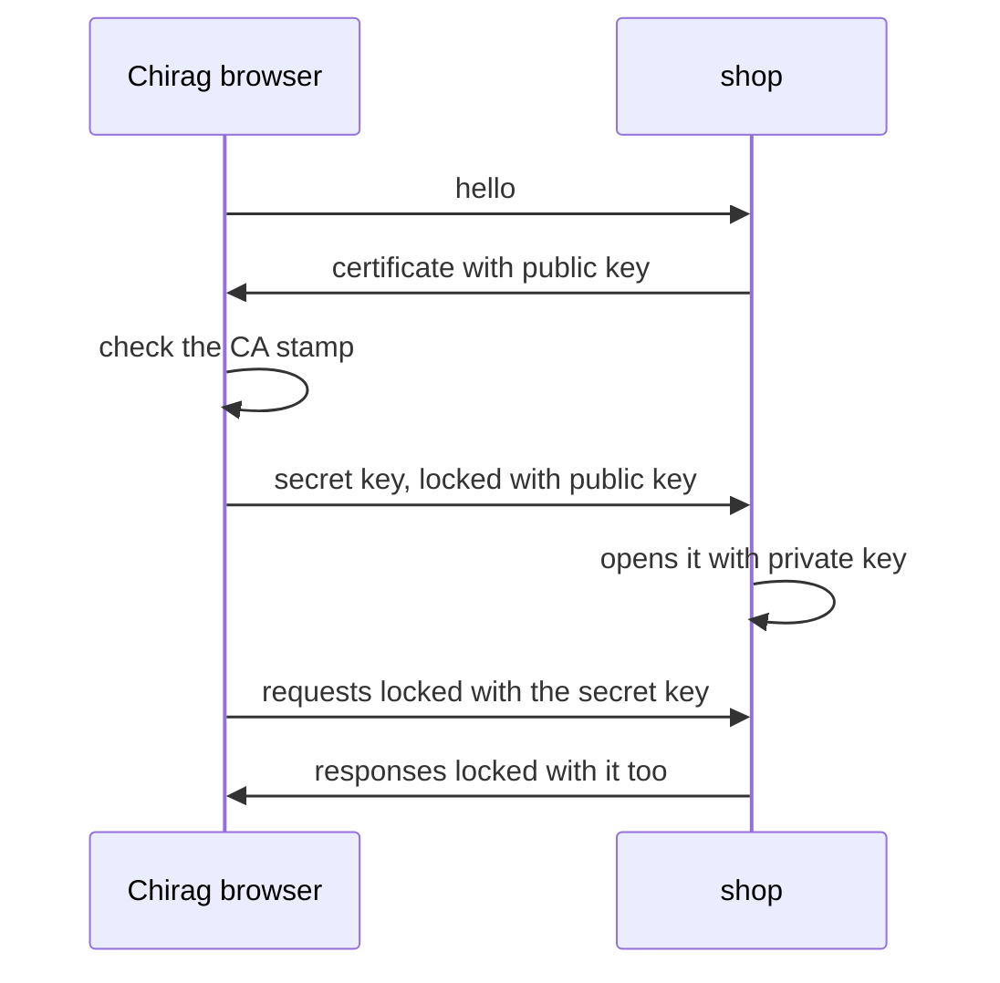

# 322: encryption in transit, TLS and https
builds on: [307 URLs and query parameters](./307-urls-and-query-parameters.md), [308 request and response, one message out, one message back](./308-request-and-response-one-message-out-one-message-back.md), [317 encryption, locking data so only a key opens it](./317-encryption-locking-data-so-only-a-key-opens-it.md), [318 public and private keys, locking without sharing a secret](./318-public-and-private-keys-locking-without-sharing-a-secret.md), [321 certificates, proving whose public key it is](./321-certificates-proving-whose-public-key-it-is.md)
section: talking over a network, part 17, ~2 min read

[321](./321-certificates-proving-whose-public-key-it-is.md) left Chirags browser trusting the shops public key. so what actually changes between http:// and https:// in the [URL](./307-urls-and-query-parameters.md), the text at the start naming the rules for talking?

TLS is a short opening conversation, a handshake, after which everything on the connection is [encrypted](./317-encryption-locking-data-so-only-a-key-opens-it.md). https is just [HTTP](./308-request-and-response-one-message-out-one-message-back.md), the same request and response, sent through that lock. the shop is the imaginary gujarati snack store these notes run on.



here are the two locks from before, with toy numbers. the browser picks a secret key, 77, and locks it with the [public key](./318-public-and-private-keys-locking-without-sharing-a-secret.md) (17 with 3233), so only the shop can open it. every request after that uses the one key lock:

```python
n, public, private = 3233, 17, 413
session = 77
sent = pow(session, public, n)
print("key on the wire:", sent)
print("shop opens it  :", pow(sent, private, n))

def lock(data, key):
    return bytes((b + key) % 256 for b in data)

def unlock(data, key):
    return bytes((b - key) % 256 for b in data)

sealed = lock(b"GET /orders?customer_id=1", session)
print("request on wire:", list(sealed[:6]))
print("shop reads     :", unlock(sealed, session))
```

```output
key on the wire: 3123
shop opens it  : 77
request on wire: [148, 146, 161, 109, 124, 188]
shop reads     : b'GET /orders?customer_id=1'
```

someone watching the wire sees 3123 and the sealed bytes, never 77. the [certificate](./321-certificates-proving-whose-public-key-it-is.md) check is why Chirag locked to the real shop key and not a thiefs, a CA, a trusted signing organization, stamped it.

i assumed the fancy public key lock did the whole job, but it only ever carries one small number, and the plain lock carries every request. one caveat: modern TLS 1.3 removed this exact way of sending the key and agrees it with another trick, Diffie-Hellman, same ending, both sides hold a key nobody on the wire does ([RFC 8446](https://www.rfc-editor.org/rfc/rfc8446.txt)).

after the handshake the headers and bodies are locked too, not just the body ([MDN](https://developer.mozilla.org/en-US/docs/Web/Security/Transport_Layer_Security)), so an API key or token you send in a header isnt readable in transit.

---
prev: [321 certificates, proving whose public key it is](./321-certificates-proving-whose-public-key-it-is.md) | next: not written yet
