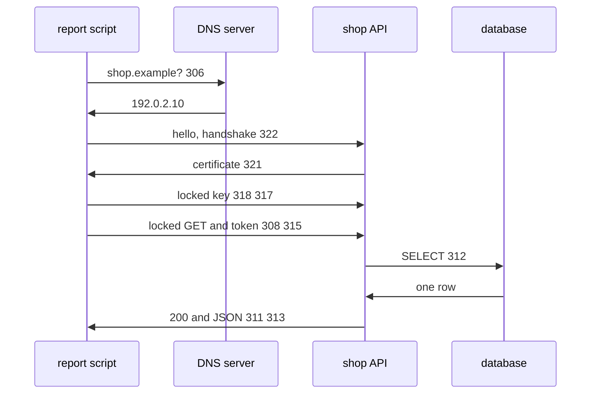

# 324: capstone, one shop order fetched from an API, hop by hop
builds on: [306 DNS, turning names into addresses](./306-dns-turning-names-into-addresses.md), [307 URLs and query parameters](./307-urls-and-query-parameters.md), [308 request and response, one message out, one message back](./308-request-and-response-one-message-out-one-message-back.md), [309 HTTP methods, GET asks and POST sends](./309-http-methods-get-asks-post-sends.md), [310 HTTP headers, notes attached to a request](./310-http-headers-notes-attached-to-a-request.md), [311 status codes, what 200, 404 and 500 mean](./311-status-codes-what-200-404-and-500-mean.md), [312 APIs, a door built for programs](./312-apis-a-door-built-for-programs.md), [313 JSON over HTTP, the answer is text until you parse it](./313-json-over-http-the-answer-is-text-until-you-parse-it.md), [314 API keys, a password for programs](./314-api-keys-a-password-for-programs.md), [315 tokens that expire, a key with a shelf life](./315-tokens-that-expire-a-key-with-a-shelf-life.md), [316 OAuth in one picture, a token without the password](./316-oauth-in-one-picture-a-token-without-the-password.md), [317 encryption, locking data so only a key opens it](./317-encryption-locking-data-so-only-a-key-opens-it.md), [318 public and private keys, locking without sharing a secret](./318-public-and-private-keys-locking-without-sharing-a-secret.md), [319 cryptographic hashes, a fingerprint you cant reverse](./319-cryptographic-hashes-a-fingerprint-you-cant-reverse.md), [320 digital signatures, proof a message came from the key holder](./320-digital-signatures-proof-a-message-came-from-the-key-holder.md), [321 certificates, proving whose public key it is](./321-certificates-proving-whose-public-key-it-is.md), [322 encryption in transit, TLS and https](./322-encryption-in-transit-tls-and-https.md), [323 latency and bandwidth, slow vs narrow](./323-latency-and-bandwidth-slow-vs-narrow.md)
section: talking over a network, wrap up, ~3 min read

one line of python fetches order 101 and, in toy numbers, the answer is back in about 0.15 seconds. how many separate things happened in that gap? [323](./323-latency-and-bandwidth-slow-vs-narrow.md) ended on the waits, and this note replays the whole section in the order it happens.

the report script wants order 101 from the shop, the imaginary gujarati snack store these notes run on. it asks the shop API, a door built for programs, with GET https://shop.example/orders/101 and a token, a key that expires, t_b2, in a header, a Name: value line. every arrow below is one step from this section:



| step | what happens | notes |
|---|---|---|
| address | the [URL](./307-urls-and-query-parameters.md) splits into scheme, host and path, and the host name goes to DNS, the lookup from name to address | [306](./306-dns-turning-names-into-addresses.md) [307](./307-urls-and-query-parameters.md) |
| trust | a certificate, an ID card stamped by a trusted organization, says this public key is the shops | [319](./319-cryptographic-hashes-a-fingerprint-you-cant-reverse.md) [320](./320-digital-signatures-proof-a-message-came-from-the-key-holder.md) [321](./321-certificates-proving-whose-public-key-it-is.md) |
| lock | the public key lock carries one secret key (newer TLS agrees it another way), and that key locks everything after | [317](./317-encryption-locking-data-so-only-a-key-opens-it.md) [318](./318-public-and-private-keys-locking-without-sharing-a-secret.md) [322](./322-encryption-in-transit-tls-and-https.md) |
| message | a GET, a method meant only to read, with headers like the token | [308](./308-request-and-response-one-message-out-one-message-back.md) [309](./309-http-methods-get-asks-post-sends.md) [310](./310-http-headers-notes-attached-to-a-request.md) |
| who | the token says who asks and expires, an API key works until deleted, OAuth is how an app got one | [314](./314-api-keys-a-password-for-programs.md) [315](./315-tokens-that-expire-a-key-with-a-shelf-life.md) [316](./316-oauth-in-one-picture-a-token-without-the-password.md) |
| answer | the API asks the database in SQL, its question language, then sends a status code, a 3 digit result like 200, and a JSON body | [311](./311-status-codes-what-200-404-and-500-mean.md) [312](./312-apis-a-door-built-for-programs.md) [313](./313-json-over-http-the-answer-is-text-until-you-parse-it.md) |
| waits | every out and back pays its latency | [323](./323-latency-and-bandwidth-slow-vs-narrow.md) |

behind the API this is all the database does:

```sql
SELECT order_id, customer_id, status FROM orders WHERE order_id = 101
```

```result
order_id | customer_id | status
101 | 1 | delivered
```

the API sends that as text, `{"order_id": 101, "customer_id": 1, "status": "delivered"}`, and only json.loads makes it a dictionary again. 323 left out the lookup and the handshake, so i give each the same 0.05 seconds as the request: 3 waits, 0.15 in all, ignoring the database, and the made up 200 byte order record of 323 adds 0.0002 at 1 MB/s. real connections wait a bit more.

i assumed one request was one step, but each step fails in its own voice. "could not resolve host" is the name lookup, a certificate error is the stamp check, a 401 is the token, a 404 is the path, a 500 is the server, and a JSON decode error means the body wasnt JSON, often an error page. read the message and you know which step to look at.

### check yourself

1. the script has a good token and fetches order 104. which status does it get, and what does it do with the body?
```sql
SELECT order_id, status FROM orders WHERE order_id = 104
```
<details><summary>answer</summary>

```result
order_id | status
104 | cancelled
```

a 200, and json.loads turns the body into a dictionary whose status is cancelled. the order exists and the request was fine, so the bad news lives in the body. the tempting answer is a 404 or a 4xx, because cancelled sounds like an error.

</details>

2. the token expired mid run. the shop answers 401 with an error page, and the script calls json.loads on it before looking at the status. what error does the log show, and what should the script have done first?
<details><summary>answer</summary>

a JSON decode error, which hides the real problem. it should check the status code first, see the 401, and (since the token ran out) swap its refresh token, the longer lived key, for a new access token. the tempting answer is a 401 error in the log, but common libraries like python requests only raise on a bad status if you ask them to, so this script never sees one.

</details>

---
prev: [323 latency and bandwidth, slow vs narrow](./323-latency-and-bandwidth-slow-vs-narrow.md) | next: [325 modules and imports, using code from other files](./325-modules-and-imports-using-code-from-other-files.md)
