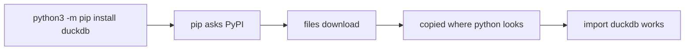

# 327: packages and pip, installing code other people wrote
builds on: [325 modules and imports, using code from other files](./325-modules-and-imports-using-code-from-other-files.md), [326 running a python script from the terminal](./326-running-a-python-script-from-the-terminal.md), [049 the terminal, running programs by typing](./049-the-terminal.md)
section: python for data work, part 3, ~2 min read

`import json` works in any python script with zero setup, so why does importing most other things fail? picture total.py, the script from [326](./326-running-a-python-script-from-the-terminal.md) for the shop, the imaginary gujarati snack store these notes run on, wanting a tool someone else already built.

a package is a bundle of [modules](./325-modules-and-imports-using-code-from-other-files.md), python files you can import, that other people wrote and shared. PyPI, the Python Package Index, is the public shelf they sit on. pip is the program that fetches one from PyPI and copies it into a folder python checks when you import.

```python
import json
print("json ok")
try:
    import dhokla_tools
except ModuleNotFoundError as e:
    print(e)
```

```output
json ok
No module named 'dhokla_tools'
```

json ships inside python. dhokla_tools, a made-up name, isnt in any folder python looks in, so the import has nothing to run. the fix is one line in the [terminal](./049-the-terminal.md):



DuckDB, a small database program for tables, is just a package like this. the `-m pip` part runs pip through the python3 you named, since a machine can have several pythons, and the package lands where that one looks.

i assumed the install name and the import name were always the same. they arent: you run pip install pyyaml, then write import yaml ([docs](https://pyyaml.org/wiki/PyYAMLDocumentation)).

PyPI is open to any python developer to publish on ([packaging glossary](https://packaging.python.org/en/latest/glossary/)), so installing a package means running a strangers code on your machine. check the spelling.

everything you install lands in one shared place, and the next note is about why that gets painful once two projects want different versions of the same package.

---
prev: [326 running a python script from the terminal](./326-running-a-python-script-from-the-terminal.md) | next: not written yet
