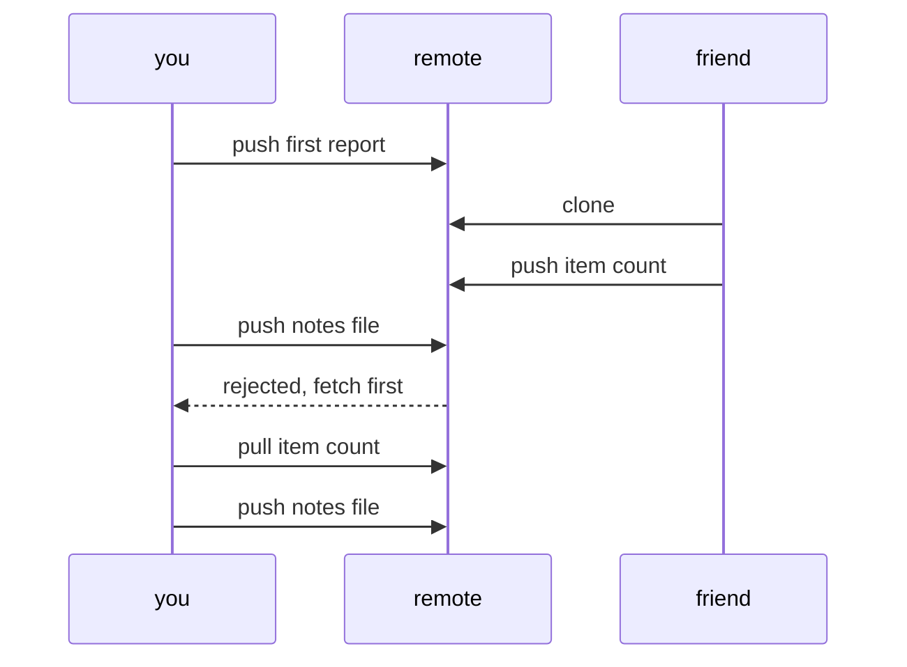

# 331: pushing and pulling, sharing code through a remote
builds on: [330 git branches, trying something without breaking main](./330-git-branches-trying-something-without-breaking-main.md), [329 git, commits as snapshots of your code](./329-git-commits-as-snapshots-of-your-code.md), [049 the terminal, running programs by typing](./049-the-terminal.md)
section: python for data work, part 7, ~2 min read

your commits from [329](./329-git-commits-as-snapshots-of-your-code.md) sit in one folder on one laptop. how does a teammate get them, and what happens if you both change the shop report at once?

a remote is another copy of the repository on a server everyone can reach, usually a site like GitHub. push uploads your new [commits](./329-git-commits-as-snapshots-of-your-code.md) (saved snapshots) to it, pull downloads commits other people pushed. here is a day with report.py, for the shop, the imaginary gujarati snack store these notes run on:



in the [terminal](./049-the-terminal.md) you connect once with git remote add origin followed by the servers address, origin being the usual nickname for the remote. clone is how your friend starts: it copies the whole repository and sets origin for them.

the rejected line is the interesting one:

```text
 ! [rejected]  main -> main (fetch first)
hint: Updates were rejected because the remote contains work that you do not have locally.
```

your friend pushed while you werent looking, so accepting your push would leave their commit out of the history. git makes you pull first. pull is two steps, fetch (download the new commits) then merge (combine both lines of work), and what a merge does when you both edited the same line is a later note.

i assumed the remote was the real project and my folder a copy, but git doesnt rank them, every clone holds the full history ([pro git](https://git-scm.com/book/en/v2/Git-Basics-Working-with-Remotes)). so a dead laptop isnt the end of the project.

---
prev: [330 git branches, trying something without breaking main](./330-git-branches-trying-something-without-breaking-main.md) | next: not written yet
