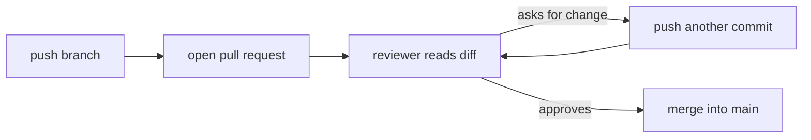

# 333: pull requests, asking for a review before merging
builds on: [332 merge conflicts, when git cant combine two edits](./332-merge-conflicts-when-git-cant-combine-two-edits.md), [331 pushing and pulling, sharing code through a remote](./331-pushing-and-pulling-sharing-code-through-a-remote.md), [330 git branches, trying something without breaking main](./330-git-branches-trying-something-without-breaking-main.md)
section: python for data work, part 9, ~2 min read

git can merge two branches in one command, so why do teams add a whole review step before anything reaches main?

a pull request is a proposal on the site holding your [remote](./331-pushing-and-pulling-sharing-code-through-a-remote.md) (the shared server copy), saying "please merge my branch into main". the site adds it on top of git, and GitLab has the same idea under the name merge request ([GitHub docs](https://docs.github.com/en/pull-requests/collaborating-with-pull-requests/proposing-changes-to-your-work-with-pull-requests/about-pull-requests)). here it is for the shop, the imaginary gujarati snack store these notes run on, using the rewrite [branch](./330-git-branches-trying-something-without-breaking-main.md) (a name on a commit) from 330:



the site shows a diff, the lines your branch removed (-) and added (+) compared to main:

```text
report.py
- print("orders: 7")
- print("items: 13")
+ print("customers: 5")
```

a reviewer spots it: your rewrite dropped the orders and items lines. you dont open a new request. you commit a fix and push to the same branch, and the open pull request picks up the new commit by itself. once it is approved (a team can require that), the branch merges, for example with the same merge as in [332](./332-merge-conflicts-when-git-cant-combine-two-edits.md).

i assumed a pull request was a git command, but git never stores it. the request and the review live on the site, and the branch is plain git underneath.

in data teams this is where a changed pipeline script gets a second pair of eyes before it can touch the real tables, so a wrong filter gets caught as a comment, not as a bad dashboard.

---

### check yourself

1. a reviewer asks you to put the orders line back. you fix report.py locally. what exactly do you do to get that fix into the open pull request?
<details><summary>answer</summary>

commit the fix on the same branch and push it. the pull request follows the branch, so the new commit appears in it. the tempting answer is to close it and open a new request, but a request is just a view of one branch, not a copy.

</details>

2. two pull requests both change line 2 of report.py ("top snack: dhokla") to different text. the first one merges into main. what happens to the second?
<details><summary>answer</summary>

it now conflicts with main, the same clash as in 332. you resolve it by hand and push the result to its branch. the tempting answer is that the second merges fine because each was approved, but approval says nothing about whether main moved under it.

</details>


---
prev: [332 merge conflicts, when git cant combine two edits](./332-merge-conflicts-when-git-cant-combine-two-edits.md) | next: [334 errors in scripts, catching them without hiding them](./334-errors-in-scripts-catching-them-without-hiding-them.md)
