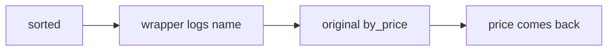

# 339: decorators, the @ shorthand for wrapping a function
builds on: [338 returning a function, building a function inside a function](./338-returning-a-function-building-a-function-inside-a-function.md), [337 functions as values, handing a function to another function](./337-functions-as-values-handing-a-function-to-another-function.md), [278 hash tables, how a dictionary finds a key without searching](./278-hash-tables-how-a-dictionary-finds-a-key-without-searching.md)
section: python for data work, part 15, ~2 min read

how do you make a function write down every time its called, without editing the function? you wrap it.

a decorator is a function that takes a function and returns a new one, and @ is shorthand for the swap. putting @logged above def by_price means by_price = logged(by_price), run right after the def.

the shop, the imaginary gujarati snack store these notes run on, has products, here a slice of 4 as [dictionaries](./278-hash-tables-how-a-dictionary-finds-a-key-without-searching.md), pythons name to value lookup. by_price is the key function from [337](./337-functions-as-values-handing-a-function-to-another-function.md), the one that gives sorted each items sort value. logged builds a wrapper, a closure (a function that keeps outer variables, from [338](./338-returning-a-function-building-a-function-inside-a-function.md)) that records the name, then calls the original it kept in fn.



```python
log = []
def logged(fn):
    def wrapper(p):
        log.append(p["name"])
        return fn(p)
    return wrapper

@logged
def by_price(p):
    return p["price"]

products = [
    {"name": "dhokla", "price": 6.0},
    {"name": "khandvi", "price": 7.5},
    {"name": "jalebi", "price": 5.0},
    {"name": "fafda", "price": 4.5},
]
print([p["name"] for p in sorted(products, key=by_price)])
print(log)
print(by_price.__name__)
```

```output
['fafda', 'jalebi', 'dhokla', 'khandvi']
['dhokla', 'khandvi', 'jalebi', 'fafda']
wrapper
```

i assumed @ was special syntax that edits the function in place, but its plain assignment: the name by_price now points at the wrapper, and the original lives on only inside it. sorted never knew.

the last line is the catch. the name by_price now says wrapper, and the python docs say functools.wraps, a helper that copies the original name back, exists for exactly this. also my wrapper takes one argument, so it only fits one-argument functions. the next ones go back to data, reading the shops files from python.

### check yourself

1. what does this print?
```python
def shout(fn):
    print("decorating", fn.__name__)
    def wrapper(p):
        return fn(p)
    return wrapper

@shout
def by_name(p):
    return p["name"]

print("defined")
```
<details><summary>answer</summary>

```output
decorating by_name
defined
```

shout runs once, at the def, before anything calls by_name. the tempting answer is just defined, from thinking a decorator waits until the function is used. only the wrapper waits.

</details>

2. with logged and by_price from above, but a 3 product list (dhokla, khandvi, jalebi), how many names does log hold after sorted(...) and then min(...), both with key=by_price?
```python
log = []
def logged(fn):
    def wrapper(p):
        log.append(p["name"])
        return fn(p)
    return wrapper

@logged
def by_price(p):
    return p["price"]

three = [
    {"name": "dhokla", "price": 6.0},
    {"name": "khandvi", "price": 7.5},
    {"name": "jalebi", "price": 5.0},
]
sorted(three, key=by_price)
min(three, key=by_price)
print(len(log))
```
<details><summary>answer</summary>

```output
6
```

each call to sorted or min runs the key once per item, so 3 and 3. the tempting answer is 3, from thinking the wrapper only logs once per list. it logs per call, and min is a second pass.

</details>

---
prev: [338 returning a function, building a function inside a function](./338-returning-a-function-building-a-function-inside-a-function.md) | next: not written yet
